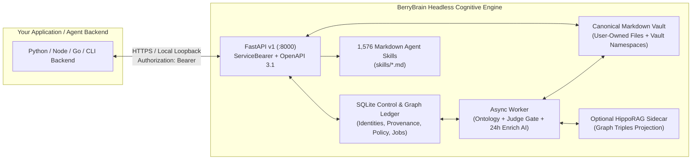

# Incorporating the BerryBrain Architecture into Your Project

BerryBrain is designed so its **knowledge governance and retrieval engine** is cleanly decoupled from its Next.js presentation layer. External developers, research teams, and AI application builders can incorporate BerryBrain in **three complementary ways**:

1. **Mode 1 — Headless Cognitive Sidecar (`Docker Compose + REST API v1`)**: Run `api` + `worker` (+ optional `hipporag`) alongside your own Python, TypeScript/Node.js, Go, Rust, CLI, editor plugin, or internal agent backend, authenticating via owner-issued expiring `ServiceBearer` tokens.
2. **Mode 2 — Domain & Cognitive Skill Extension (`skills/*.md` + `GET /api/v1/ai/skills`)**: Add or query domain-specific Markdown Agent Skills alongside BerryBrain's **1,576 standardized skills**, enforcing structured synthesis without letting parametric model priors override canonical vault evidence.
3. **Mode 3 — Adopting the 5-Invariant Architectural Blueprint**: Implement BerryBrain's core consistency, provenance, ontology-gate, reversible-feedback, and two-tier retrieval contracts directly inside an existing RAG, PKM, or agent-memory stack.



---

## Mode 1: Run BerryBrain as a Headless Cognitive Sidecar (`REST API v1`)

If your application needs durable Markdown ingestion, OCR/PDF/Whisper attachment extraction, an ontology-governed semantic graph, hybrid + reranked retrieval, and citation-grounded Q&A without building those pipelines from scratch, run BerryBrain as a local or private-network sidecar service.

### 1. Start the Core Services

You can run the full stack (`web`, `api`, `worker`, optional `hipporag`) or target `api` + `worker` directly on a private backend network:

```bash
cp .env.example .env
# Set strong BERRYBRAIN_SESSION_SECRET and BERRYBRAIN_API_TOKEN values in .env
docker compose up -d api worker web
# Optional multi-hop structural sidecar:
docker compose --profile cognitive-advanced up -d
```

Complete one-time owner setup and **1-Click Auto Config** (Local Ollama or Cloud OpenAI-compatible provider) in the browser UI, or inspect live readiness via:

- `GET /health` — database schema compatibility (`schema 25` in v1.5.0) and service health
- `GET /api/v1` — public API discovery
- `GET /api/v1/openapi.json` — machine-readable OpenAPI 3.1 contract
- `GET /api/v1/docs` — interactive Swagger UI

### 2. Issue a Dedicated Expiring Service Token

Never reuse `BERRYBRAIN_API_TOKEN` (the internal worker credential) and **never embed a service token in a public browser bundle or mobile binary**. Issue a dedicated per-application credential (`1–365` days) from an authenticated owner session with CSRF protection:

```text
POST /api/v1/security/service-tokens
Content-Type: application/json
X-CSRF-Token: <bb_csrf cookie value>

{"name": "my-agent-backend", "expires_in_days": 90}
```

Store the returned `token` in your backend's secret manager and pass `Authorization: Bearer <token>` on server-to-server calls. You can list active tokens (`GET /api/v1/security/service-tokens`) and revoke any token independently (`POST /api/v1/security/service-tokens/{id}/revoke`) without disrupting the worker.

### 3. Drop In the Zero-Dependency Reference Clients

BerryBrain ships two audited, zero-dependency reference adapters in [`examples/`](../examples/README.md):

- **Python 3.11+**: [`examples/berrybrain_client.py`](../examples/berrybrain_client.py) (`BerryBrainClient`, `APIError`, `NoRedirects`)
- **Node.js 20+ / TypeScript ESM**: [`examples/berrybrain_client.mjs`](../examples/berrybrain_client.mjs) (`BerryBrainClient`, `BerryBrainApiError`)

Both adapters enforce BerryBrain's transport safety rules out of the box:
- Reject HTTP redirects so `Authorization: Bearer` headers never leak across origins;
- Reject URLs containing embedded credentials, query strings, fragments, or `..` path traversal;
- Preserve `X-Correlation-ID` on errors for deterministic log correlation;
- Require `base_content_hash` on note updates and never silently retry `HTTP 409` conflicts.

#### Python Integration Workflow

```python
import os
from examples.berrybrain_client import APIError, BerryBrainClient

bb = BerryBrainClient(
    os.environ["BERRYBRAIN_URL"],           # e.g. "http://127.0.0.1:8000"
    os.environ["BERRYBRAIN_SERVICE_TOKEN"], # owner-issued service token
)

# 1. Discover physical vault namespaces in the shared workspace
vaults = bb.list_vaults()

# 2. Write canonical Markdown (returns id, stableId, path, content_hash, vaultId)
note = bb.create_note(
    title="Event Sourcing Invariants",
    content="# Event Sourcing\n Projections are rebuildable; the event log is canonical.",
    folder="inbox",
)

# 3. Wait for bounded background assimilation (PARSE -> ASSIMILATE -> EMBED -> EXPAND_GRAPH)
status = bb.wait_until_ready(note["path"], timeout_seconds=60.0)

# 4. Optimistic concurrency update (HTTP 409 if edited elsewhere)
try:
    note = bb.update_note(
        note["path"],
        note["content"] + "\n\nDeleting a source event must invalidate derived views.",
        base_content_hash=note["content_hash"],
    )
except APIError as exc:
    if exc.status == 409:
        current = bb.read_note(note["path"])
        raise RuntimeError(f"Merge required against {current['content_hash']}") from exc
    raise

# 5. Hybrid + Graph retrieval and grounded GraphRAG inference
search_hits = bb.search("rebuildable projections event log", limit=5)
inference = bb.ask("How should derived views behave when a canonical source changes?")

if inference["status"] == "answered":
    print(inference["answer"])
    # Record reversible human feedback without mutating LLM weights
    bb.inference_feedback(inference["inferenceId"], action="upvoted")
```

#### Node.js / TypeScript Integration Workflow

```javascript
import { BerryBrainClient } from "./examples/berrybrain_client.mjs";

const bb = new BerryBrainClient(
  process.env.BERRYBRAIN_URL,
  process.env.BERRYBRAIN_SERVICE_TOKEN,
);

// Query matched Markdown Agent Skills for a specialized synthesis task
const skillMatch = await bb.matchSkills("Write an architecture RFC on derived state", {
  taskType: "ask",
});

// Grounded GraphRAG synthesis
const answer = await bb.ask("Draft a concise RFC summary from my Event Sourcing notes.");
console.log({
  status: answer.status,
  matchedSkills: skillMatch.matchedSkills.map((s) => s.id),
  evidenceCount: answer.evidence?.length ?? 0,
  supportMean: answer.confidence?.score ?? null, // null when unscored; never a truth probability
});

// Export the governed semantic graph as W3C JSON-LD or Turtle
const turtleGraph = await bb.exportOntology({ format: "turtle" });
```

### 4. High-Value Integration Endpoints

| Capability | Endpoint | Key Contract Detail |
| --- | --- | --- |
| Physical vault namespaces | `GET /api/v1/vault/namespaces` | Lists `default` and named physical vaults (`workspaceModel: "shared"`). Organizational namespaces, not ACL boundaries. |
| Canonical note CRUD | `GET/POST /api/v1/notes`, `GET/PUT/DELETE /api/v1/notes/{path}` | `PUT` requires `base_content_hash` (`409` on conflict). Edits/deletions trigger scoped provenance repair. |
| Pipeline readiness | `GET /api/v1/notes/{path}/status` | Reports active stage, `graphReady`, degraded stages, and median-based ETA. Use bounded backoff polling (`2, 4, 8, 15s`). |
| Cognitive attachments | `POST /api/v1/notes/{path}/attachments` | Sandboxed PDF extraction, Tesseract OCR, and Faster Whisper transcription become chunked graph-linked evidence. |
| Hybrid + graph search | `GET /api/v1/search?q=...&limit=10` | Combines SQLite FTS5 lexical search, dense embeddings, and admitted graph neighborhood signals. |
| Grounded synthesis | `POST /api/v1/graph/infer` | Returns `status`, `answer`, `evidence`, `references`, `routes`, and descriptive `confidence`. Never render an abstention as a factual claim. |
| Agent skill router | `GET /api/v1/ai/skills?query=...&task_type=ask` | Inspects the 1,576 `.md` skills library and returns context-matched skills for a prompt. |
| Snapshot graph paging | `GET /api/v1/graph/nodes`, `GET /api/v1/graph/edges?compact=true`, `GET /api/v1/graph/delta?since_version=` | Check `graphVersion` across pages; reload if `graphVersion` changes mid-scan or `requiresFullRefresh=true`. |
| W3C ontology export | `GET /api/v1/graph/ontology/export?format=json-ld\|turtle` | Exports SKOS, PROV-O, schema.org, OWL, and Dublin Core triples validated against SHACL rules. |
| Reversible feedback | `POST /api/v1/graph/nodes/{id}/confirm\|ignore`, `POST /api/v1/graph/inferences/{id}/feedback` | Appends source-scoped human policy (`model_weights_updated=false`). |

---

## Mode 2: Extend BerryBrain with Custom Markdown Agent Skills (`skills/*.md`)

BerryBrain v1.5 ships **1,576 standardized Markdown Agent Skills** under [`skills/`](../skills/README.md) (15 priority-1 BerryBrain core skills, 177 scientific skills, 1,100 scientific reference modules, 265 Fabric cognitive patterns, and 19 Anthropic workflow skills).

If you embed BerryBrain in a domain-specific product (for example legal-compliance review, clinical study synthesis, or software RFC governance), you can drop custom `.md` skills into `skills/` without modifying Python or TypeScript code.

### Standard BerryBrain Skill Format

```markdown
---
id: domain-security-adr
name: Security Architecture Decision Record
category: engineering
source_repo: custom/project
description: Structures security architecture decisions strictly from verified vault evidence.
priority_tier: 1
recommended_max_tokens: 1800
task_types:
  - ask
  - synthesis
triggers:
  - security adr
  - threat decision record
keywords:
  - threat-model
  - trust-boundary
  - mitigation
---

# Structural Contract
1. **Context & Trust Boundaries** — cite canonical notes via `[Title](bbref:<evidenceId>)`.
2. **Admitted Graph Evidence vs. Open Gaps** — distinguish confirmed relations from unresolved gaps.
3. **Decision & Reversibility Plan** — state operational trade-offs without inventing unsupported claims.
```

Every skill operates under BerryBrain's **Mandatory Epistemic Protocol**:
- **Vault & Graph First**: Skills govern *structure, analytical rigor, and checklist completeness*; they never authorize substituting ungrounded model memory for missing vault evidence.
- **Verifiable Citations**: Factual assertions cite `[Title](bbref:<evidenceId>)` resolved against live turn `references`.
- **24h Enrich AI Integration**: External sources verified by continuous 24h enrichment (`RESEARCH_GRAPH`, `VALIDATE_GRAPH_NODE_WITH_WEB`) retain explicit epistemic stances (`source_supports`, `source_expands`, `source_contradicts`).

---

## Mode 3: Adopt the 5-Invariant Architectural Blueprint in Your Own Stack

Even if your team uses PostgreSQL, pgvector/Qdrant, LangGraph, LlamaIndex, or a custom Rust/Go service instead of running BerryBrain's containers, you can incorporate the **BerryBrain Architecture** as an engineering blueprint by enforcing its five core invariants:

### Invariant 1 — Canonical Human Sources vs. Rebuildable Derived State
- Keep user-authored documents (Markdown files, ADR records, or immutable source rows keyed by `stable_id` + `content_hash`) strictly separate from derived representations (chunks, vector embeddings, extracted entities, typed edges, clusters, and sidecar triples).
- Ensure every derived table can be dropped and deterministically rebuilt from canonical sources plus the human feedback ledger. Never let an AI enrichment job silently overwrite canonical source text.

### Invariant 2 — Operational Ontology & Multi-Signal Admission Gate
- Do not dump raw LLM-extracted OpenIE triples straight into retrieval. Validate candidate nodes and directed edges against an explicit domain/range ontology (SKOS/PROV-O/OWL/SHACL) and a bounded quality rubric (deterministic rules, single-model Judge, or multi-model Judge committee).
- Route generic metadata noise, malformed endpoints, or low-evidence sentences into **semantic quarantine** outside active graph and RAG indexes.
- Report **evidence support** only on eligible derived artifacts (never on raw canonical notes or vaults), using the mean of distinct recorded observations plus a descriptive bounded-signal uncertainty interval—never presenting uncalibrated LLM scores as factual truth probabilities.

### Invariant 3 — Dependency-Propagating Provenance Invalidation
- Standard RAG pipelines suffer from *zombie knowledge* when sources are edited or deleted. Attach fine-grained `source_note_id` + `content_hash` provenance to every derived concept, edge, cluster assignment, and insight.
- On a meaningful edit or deletion:
  1. Supersede in-flight background jobs for older source hashes;
  2. Strip only the modified source's provenance from shared nodes and edges;
  3. Recalculate shared evidence support from surviving sources;
  4. Purge derived nodes/edges whose surviving source count drops to zero, and expire downstream insights or multi-hop relationships that depended on purged artifacts.

### Invariant 4 — Append-Only, Scoped, Reversible Human Feedback (`model_weights_updated=false`)
- Record user confirmations, rejections, renames, merges, splits, and answer corrections in an append-only policy ledger keyed by canonical artifact identity and overlapping source scope.
- Resolve applicable positive/negative policy rules before worker extraction, Judge evaluation, and retrieval ranking so deleted noise never resurfaces on re-indexing—while keeping unrelated domains free to use the same term and preserving instant audit/undo without fine-tuning model weights.

### Invariant 5 — Corpus-Aware Two-Tier Retrieval
- **Tier 1 (Fast Lookup)**: Use sub-second lexical + dense Reciprocal Rank Fusion (RRF) for direct note and passage lookup.
- **Tier 2 (Multi-Hop Synthesis)**: Expand the candidate pool across lexical, dense, and admitted graph routes, then re-order with a local Cross-Encoder reranker (`ms-marco-MiniLM-L-6-v2` or equivalent). Treat structural graph traversal as **corpus-adaptive**: explicit cross-document links (`[[wikilinks]]`, typed `@references`, curated ontology edges) yield genuine structural recall gains, whereas on noisy open-extraction text the primary recall gain comes from **candidate-pool expansion paired with Cross-Encoder reranking**.

---

## Security & Operational Boundaries Checklist

Before shipping an integration against BerryBrain, verify:

- [ ] **Shared-workspace awareness**: Your integration treats the BerryBrain instance as a single owner-managed workspace. Multi-tenant customer isolation uses separate BerryBrain deployments and storage roots.
- [ ] **Server-side credential custody**: Service tokens live exclusively in backend environment variables or secret stores, never in client-side JavaScript or public repositories.
- [ ] **Human-only supervised plans**: Your backend uses `POST /api/v1/notes` / `PUT /api/v1/notes/{path}` for trusted server-to-server writes, and respects that `/api/v1/ask/action-plans/*` approvals require an interactive human browser session + CSRF token.
- [ ] **Abstention & uncertainty fidelity**: Your UI distinguishes `answered` from abstentions/provider errors (`HTTP 502/503`), resolves `bbref:` markers only against verified `references`, and labels `confidence` as *evidence support* rather than probability of truth.

## Related Documentation

- [REST API v1 Contract & Error Reference](api.md)
- [System & Runtime Architecture](architecture.md)
- [Evidence Support & Confidence Methodology](confidence-model.md)
- [Feedback-Driven Policy Adaptation](learning-and-feedback.md)
- [Operational Ontology & Visual Semantics](ontology.md)
- [Zero-Dependency Python & Node.js Reference Clients](../examples/README.md)
- [1,576 Standardized Markdown Agent Skills](../skills/README.md)
