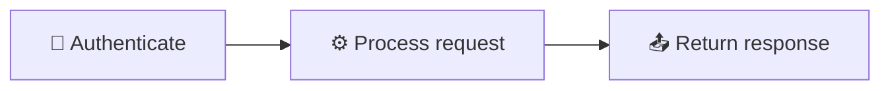

<!-- Source: https://github.com/SuperiorByteWorks-LLC/agent-project | License: Apache-2.0 | Author: Clayton Young / Superior Byte Works, LLC (Boreal Bytes) -->

# Mermaid Diagram Style Guide

> **For AI agents:** Read this file for all core styling rules. Then use the [diagram selection table](#choosing-the-right-diagram) to pick the right type and follow its link — each type has its own file with a production-quality exemplar, tips, and a copy-paste template.
>
> **For humans:** This guide + the linked diagram files provide a starting point for readable diagrams; validate rendering and accessibility in the actual destination. Reference it from your `AGENTS.md` or contributing guide.

**Target platform:** Mermaid-capable Markdown; check the particular host and version.
**Verified renderer:** Mermaid 12.0.0. See [Current rendering and validation](current-rendering.md) for CLI export, browser APIs, and accessibility results.
These are house-style preferences, not Mermaid grammar or universal GitHub guarantees.
All business workflows, endpoints, scores, and dates in examples are illustrative.
**Design goal:** Minimal professional styling that renders beautifully in both GitHub light and dark modes, is accessible to screen readers, and communicates clearly with zero visual noise.

---

## Quick Start for Agents

1. **Pick the diagram type** → [Selection table](#choosing-the-right-diagram)
2. **Open that type's file** → Copy the template, fill in your content
3. **Apply styling from this file** → Emoji from [approved set](#approved-emoji-set), colors from [approved palette](#github-compatible-color-classes)
4. **Add accessibility** → `accTitle` + `accDescr` (or italic Markdown paragraph for unsupported types)
5. **Verify** → Renders in light mode, dark mode, and screen reader

---

## Core Principles

| #   | Principle                      | Rule                                                                                                   |
| --- | ------------------------------ | ------------------------------------------------------------------------------------------------------ |
| 1   | **Clarity at every scale**     | Simple diagrams stay flat. Complex ones use subgraphs. Very complex ones split into overview + detail. |
| 2   | **Accessibility always**       | Use supported SVG metadata plus a visible description; verify the exported result.                                             |
| 3   | **Theme neutral**              | Prefer host themes and documented per-type styling; verify contrast.                              |
| 4   | **Semantic clarity**           | `snake_case` node IDs that match labels. Active voice. Sentence case.                                  |
| 5   | **Consistent styling**         | Same emoji = same meaning everywhere. Same shapes = same semantics.                                    |
| 6   | **Minimal professional flair** | A touch of emoji + strategic bold + optional `classDef` — never more.                                  |

---

## Accessibility Requirements

**Use both annotations where the renderer supports them:**

```
accTitle: Short Name 3-8 Words
accDescr: One or two sentences explaining what this diagram shows and what insight the reader gains from it
```

- `accTitle` — 3–8 words, plain text, names the diagram
- `accDescr` — 1–2 sentences; single-line form is convenient. Mermaid also supports `accDescr { ... }` across multiple lines

Mermaid 12.0.0 emits these annotations for flowchart, sequence, class, state, ER,
gantt, pie, git graph, journey, requirement, quadrant, XY, architecture, packet,
radar, and treemap. Block, kanban, mindmap, and Sankey need a visible text alternative.
Timeline accepts annotations but the tested SVG omitted both; C4 omitted the SVG title.
ZenUML is a separate plugin. See the tested matrix in [Current rendering and validation](current-rendering.md).
A paragraph does not automatically become an SVG accessible name; include meaningful image
alt text when exporting, and a data table or detailed equivalent for complex figures.

> **ZenUML note:** ZenUML requires an external plugin and may not render on GitHub. Prefer standard `sequenceDiagram` syntax.

---

## Theme Configuration

### ✅ Do: No theme directive (GitHub auto-detects)



### Prefer host defaults unless custom styling is required

```
%% Custom colors may reduce contrast; inspect both themes
style A fill:#e8f5e9
%%{init: {'theme':'base'}}%%
```

---

## Approved Emoji Set

One emoji per node, at the start of the label. Same emoji = same meaning across all diagrams in a project.

### Systems & Infrastructure

| Emoji | Meaning                           | Example                   |
| ----- | --------------------------------- | ------------------------- |
| ☁️    | Cloud / platform / hosted service | `[☁️ AWS Lambda]`         |
| 🌐    | Network / web / connectivity      | `[🌐 API gateway]`        |
| 🖥️    | Server / compute / machine        | `[🖥️ Application server]` |
| 💾    | Storage / database / persistence  | `[💾 PostgreSQL]`         |
| 🔌    | Integration / plugin / connector  | `[🔌 Webhook handler]`    |

### Processes & Actions

| Emoji | Meaning                          | Example                   |
| ----- | -------------------------------- | ------------------------- |
| ⚙️    | Process / configuration / engine | `[⚙️ Build pipeline]`     |
| 🔄    | Cycle / sync / recurring process | `[🔄 Retry loop]`         |
| 🚀    | Deploy / launch / release        | `[🚀 Ship to production]` |
| ⚡    | Fast action / trigger / event    | `[⚡ Webhook fired]`      |
| 📦    | Package / artifact / bundle      | `[📦 Docker image]`       |
| 🔧    | Tool / utility / maintenance     | `[🔧 Migration script]`   |
| ⏰    | Scheduled / cron / time-based    | `[⏰ Nightly job]`        |

### People & Roles

| Emoji | Meaning                      | Example              |
| ----- | ---------------------------- | -------------------- |
| 👤    | User / person / actor        | `[👤 End user]`      |
| 👥    | Team / group / organization  | `[👥 Platform team]` |
| 🤖    | Bot / agent / automation     | `[🤖 CI bot]`        |
| 🧠    | Intelligence / decision / AI | `[🧠 ML classifier]` |

### Status & Outcomes

| Emoji | Meaning             

*(Instruções condensadas para caber no orçamento de contexto do BerryBrain)*

---
## Protocolo Epistêmico Obrigatório do BerryBrain (Vault-First & Enrich AI 24h)
1. **Soberania do Próprio Conteúdo (Vault & Grafo):** Aplique a metodologia e estrutura desta skill utilizando **exclusivamente** os fatos, trechos, conceitos e conexões presentes nas notas do usuário e no Grafo de Conhecimento fornecidos no pacote de evidências.
2. **Integração com Enrich AI 24h & Fontes Web Verificadas:** Caso o pacote de evidências contenha nós validados ou expandidos pelo monitoramento contínuo 24h (`source_supports`, `source_expands`, `source_contradicts`, `externalResearch`), incorpore essas fontes verificadas com transparência.
3. **Citação Verificável Obrigatória:** Toda afirmação factual extraída das evidências deve conter o link canônico `[Título da Fonte](bbref:<evidenceId>)`. Nunca invente citações ou dados fora das evidências fornecidas.

