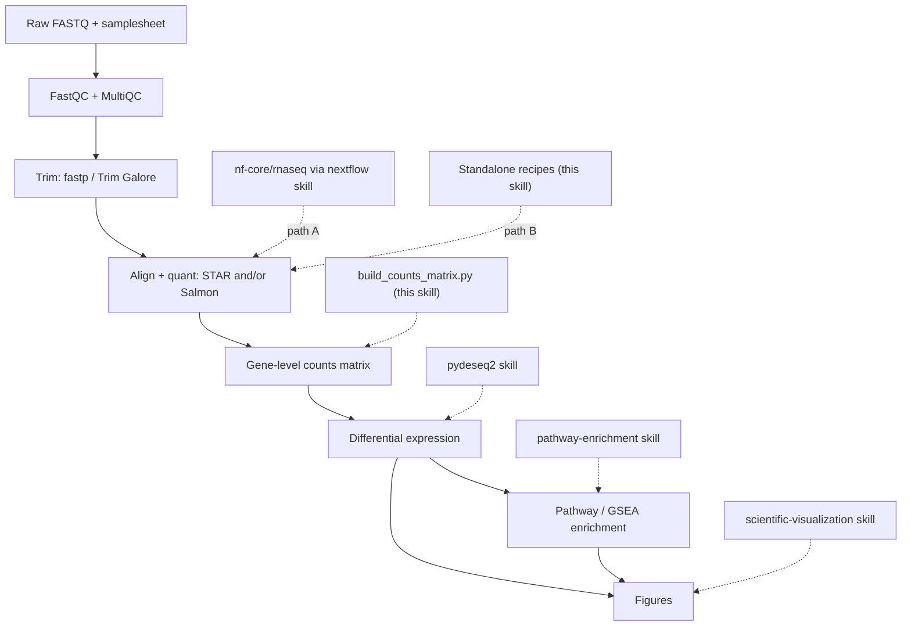

# Bulk RNA-seq

## Overview

This skill prepares bulk RNA-seq reads and quantification output for a reproducible gene-level comparison. It owns sample validation, reads-to-counts recipes, and the count/metadata handoff; downstream statistical fitting and enrichment remain in their specialist skills.

"Defensible" means three things, applied throughout:
- **Reproducible** — pinned pipeline/tool versions, containers where possible, recorded parameters, fixed random seeds.
- **Quality-gated** — QC is inspected and acted on before, during, and after quantification, not skipped.
- **Statistically sound** — adequate replication, a design that matches the biology, counts handled correctly, and FDR-controlled testing.

The pipeline is: **FastQC/trim → align/quant (STAR/Salmon) → counts → DE (pydeseq2) → enrichment (pathway-enrichment) → figures**.

## When to Use This Skill

Use this skill when the user wants to:
- Go from FASTQ files (or a sequencing run) to differentially expressed genes and pathways.
- Run or configure `nf-core/rnaseq`, or align/quantify with STAR, Salmon, or featureCounts.
- Turn Salmon/STAR/featureCounts output into a counts matrix ready for DESeq2/PyDESeq2.
- Design or sanity-check a bulk RNA-seq experiment (replicates, batch, strandedness) before committing compute.
- Scope an end-to-end RNA-seq analysis and decide which tools and skills to chain.

This is **bulk** RNA-seq (samples = biological specimens). For single-cell/nuclei data use `scanpy`; for the DE statistics alone use `pydeseq2`; for enrichment alone use `pathway-enrichment`.

## The Pipeline at a Glance



## Two Upstream Paths — Pick One

The reads → counts stage can be run two ways. Both produce gene-level counts,
but STAR/featureCounts and Salmon/tximport do not generally give identical or
interchangeable values: assignment rules, multimapping, and effective-length
corrections differ. Choose one quantification route for the entire comparison.

| Use **Path A — `nf-core/rnaseq`** when… | Use **Path B — standalone tools** when… |
|------------------------------------------|------------------------------------------|
| You want the field-standard, audited, citable pipeline with one command | You have a few samples and want to learn/inspect each step |
| Many samples, or you'll scale to HPC/cloud | No Nextflow/containers available, or a constrained environment |
| Reproducibility and a full MultiQC report matter most | You need a non-standard step the pipeline doesn't expose |
| → Drive it through the **`nextflow`** skill | → Follow `references/upstream-manual.md` |

When unsure, prefer **Path A**: `nf-core/rnaseq` already wires together FastQC → trimming → STAR/Salmon → quantification → tximport → MultiQC with sensible, reviewed defaults, which is the most defensible option. Path B exists for transparency and constrained setups.

Both paths converge on a **gene-level counts matrix**. Preserve whether counts are
raw or length-scaled, the transcript-to-gene mapping release, and any offsets.
Length-scaled counts must not receive a second transcript-length correction.

## Setup

```bash
# This skill's glue (bridge + handoffs) — Python
uv pip install "pytximport==0.13.0" pandas numpy

# Downstream skills install their own deps:
#   pydeseq2 skill           -> uv pip install pydeseq2
#   pathway-enrichment skill -> uv pip install gseapy gprofiler-official

# Path A (nf-core): only Nextflow + a container engine are needed — see the `nextflow` skill.

# Path B (standalone tools): install via bioconda. Pin versions for reproducibility.
conda create -n rnaseq -c conda-forge -c bioconda --strict-channel-priority \
  fastqc fastp trim-galore "star=2.7.11b" "salmon=2.8.0" subread multiqc
```

Reviewed against nf-core/rnaseq 3.27.0, STAR 2.7.11b documentation, Salmon 2.8.0,
pytximport 0.13.0 and PyDESeq2 0.5.4. The bundled Python bridge and a tiny Salmon
index/quant run were executed; the full Nextflow/STAR/trimming recipes are illustrative,
not an end-to-end validation. Salmon 2.x cannot read older C++ indexes: rebuild them.
The bridge's length-scaled Salmon route is for full-length bulk RNA-seq; 3′ counting
assays need original counts without transcript-length correction.

Record the exact versions you use (pipeline revision, tool versions, reference genome + annotation release) — they belong in the methods section and make the analysis reproducible.

Version 2.0 makes STAR strandedness explicit and rejects ambiguous samples, gene sets,
transcript mappings and fractional featureCounts data that older bridge versions accepted.

## Quick Start

### Path A — nf-core/rnaseq (recommended)

```bash
# 0. Validate the samplesheet first (catches the most common failures early)
python scripts/validate_samplesheet.py --samplesheet samplesheet.csv --nfcore

# 1. Smoke-test the environment with tiny bundled data
nextflow run nf-core/rnaseq -r 3.27.0 -profile test,docker --outdir test_results

# 2. Real run: pin the revision, pick an aligner, pass a samplesheet + reference
nextflow run nf-core/rnaseq -r 3.27.0 \
  -profile docker \
  --input samplesheet.csv \
  --genome GRCh38 \
  --aligner star_salmon \
  --outdir results \
  -resume
```

`nf-core/rnaseq` runs tximport internally, so gene counts come out **already merged** — no bridge script needed. Use `results/star_salmon/salmon.merged.gene_counts_length_scaled.tsv` for DE. Samplesheet format, aligner choice, and outputs: `references/upstream-nfcore.md`. For engine/HPC/cloud/container detail, use the **`nextflow`** skill.

### Path B — standalone STAR/Salmon (abbreviated)

```bash
mkdir -p qc/
fastqc -o qc/ reads/*.fastq.gz                      # 1. QC raw reads
fastp -i s1_R1.fq.gz -I s1_R2.fq.gz \
      -o s1_R1.trim.fq.gz -O s1_R2.trim.fq.gz \
      --thre

*(Instruções condensadas para caber no orçamento de contexto do BerryBrain)*

---
## Protocolo Epistêmico Obrigatório do BerryBrain (Vault-First & Enrich AI 24h)
1. **Soberania do Próprio Conteúdo (Vault & Grafo):** Aplique a metodologia e estrutura desta skill utilizando **exclusivamente** os fatos, trechos, conceitos e conexões presentes nas notas do usuário e no Grafo de Conhecimento fornecidos no pacote de evidências.
2. **Integração com Enrich AI 24h & Fontes Web Verificadas:** Caso o pacote de evidências contenha nós validados ou expandidos pelo monitoramento contínuo 24h (`source_supports`, `source_expands`, `source_contradicts`, `externalResearch`), incorpore essas fontes verificadas com transparência.
3. **Citação Verificável Obrigatória:** Toda afirmação factual extraída das evidências deve conter o link canônico `[Título da Fonte](bbref:<evidenceId>)`. Nunca invente citações ou dados fora das evidências fornecidas.

