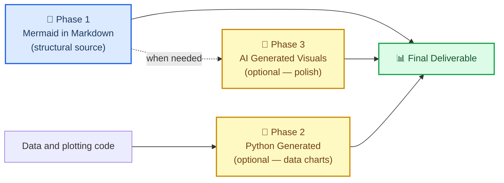

# Markdown and Mermaid Writing

## Overview

This skill provides an optional house style for **Markdown documentation with Mermaid
structural diagrams**. Follow the requested output format, existing repository conventions,
and journal requirements first. This skill does not replace scientific analysis or plotting.

A relationship expressed as Mermaid inside a `.md` file is editable text that diffs
cleanly in git. A compatible host renders it without a separate user build step.
It renders where the host has Mermaid support; plain Markdown viewers may show only code,
and platforms/extensions ship different Mermaid versions. It uses
a compact source representation, though token use depends on the diagram. Exporting
SVG/PNG requires a renderer; retain the diagram source alongside exported figures.

> "The more you get your reports and files in .md in just regular text, which mermaid is
> as well as being a simple 'script language'. This just helps with any downstream rendering
> and especially AI generated images (using mermaid instead of just long form text to
> describe relationships < tokens). Additionally mermaid can render along with markdown for
> easy use almost anywhere by humans or AI."
>
> — Clayton Young (@borealBytes), K-Dense Discord, 2026-02-19

## When to Use This Skill

Use this skill when:

- Writing a requested Markdown report, README, methods overview, or research note
- Diagramming a workflow, data pipeline, schema, state machine, or conceptual relationship
- Maintaining editable Mermaid sources and their rendered SVG/PNG exports

Use scientific plotting tools directly for measured data, uncertainty, statistical graphics,
exact geometry, or publication figures that Mermaid cannot faithfully represent. Mermaid
is not a required precursor to a quantitative chart or an existing SVG/code-native asset.

## 🎨 The Source Format Philosophy

### Why text-based diagrams win

| What matters | Mermaid in Markdown | Python / AI Image |
| ----------------------------- | :-----------------: | :---------------: |
| Git diff readable | ✅ text source | Plotting code/SVG can also be text |
| Editable source | ✅ | Plotting scripts and vector sources are editable |
| Compact relationship notation | Often | Depends on representation |
| Native preview | Host/version dependent | Viewer/format dependent |
| Parseable by AI without vision | ✅ | ❌ |
| Works in destination | Check Mermaid support and version | Check image format support |
| Accessible (screen readers) | Check SVG metadata and text alternative | Provide alt text/data table |
| Convertible to image later | ✅ anytime | — already image |

### The three-phase workflow

Retain Mermaid for structural diagrams and data/code for quantitative charts. An AI illustration
is not a quantitative conversion; verify every label and relationship against its sources.

### What Mermaid can express

This skill includes 23 diagram-type guides plus a composition guide. Mermaid supports
additional types; these references are a curated subset, not an exhaustive version catalogue:

| Use case | Diagram type | File |
| -------------------------------------------- | ---------------- | ---------------------------------------------------- |
| Experimental workflow / decision logic | Flowchart | `references/diagrams/flowchart.md` |
| Service interactions / API calls / messaging | Sequence | `references/diagrams/sequence.md` |
| Data model / schema | ER diagram | `references/diagrams/er.md` |
| State machine / lifecycle | State | `references/diagrams/state.md` |
| Project timeline / roadmap | Gantt | `references/diagrams/gantt.md` |
| Proportions / composition | Pie | `references/diagrams/pie.md` |
| System architecture (zoom levels) | C4 | `references/diagrams/c4.md` |
| Concept hierarchy / brainstorm | Mindmap | `references/diagrams/mindmap.md` |
| Chronological events / history | Timeline | `references/diagrams/timeline.md` |
| Class hierarchy / type relationships | Class | `references/diagrams/class.md` |
| User journey / satisfaction map | User Journey | `references/diagrams/user_journey.md` |
| Two-axis comparison / prioritization | Quadrant | `references/diagrams/quadrant.md` |
| Requirements traceability | Requirement | `references/diagrams/requirement.md` |
| Flow magnitude / resource distribution | Sankey | `references/diagrams/sankey.md` |
| Numeric trends / bar + line charts | XY Chart | `references/diagrams/xy_chart.md` |
| Component layout / spatial arrangement | Block | `references/diagrams/block.md` |
| Work item status / task columns | Kanban | `references/diagrams/kanban.md` |
| Cloud infrastructure / service topology | Architecture | `references/diagrams/architecture.md` |
| Multi-dimensional comparison / skills radar | Radar | `references/diagrams/radar.md` |
| Hierarchical proportions / budget | Treemap | `references/diagrams/treemap.md` |
| Binary protocol / data format | Packet | `references/diagrams/packet.md` |
| Git branching / merge strategy | Git Graph | `references/diagrams/git_graph.md` |
| Code-style sequence (programming syntax) | ZenUML | `references/diagrams/zenuml.md` |
| Multi-diagram composition patterns | Complex Examples | `references/diagrams/complex_examples.md` |

> 💡 **Pick the right type, not the easy one.** Don't default to flowcharts for everything.
> A timeline beats a flowchart for chronological events. A sequence beats a flowchart for
> service interactions. Scan the table and match.

---

## 🔧 Core workflow

### Step 1: Identify the document type

Check if a template exists before writing from scratch:

*(Instruções condensadas para caber no orçamento de contexto do BerryBrain)*

---
## Protocolo Epistêmico Obrigatório do BerryBrain (Vault-First & Enrich AI 24h)
1. **Soberania do Próprio Conteúdo (Vault & Grafo):** Aplique a metodologia e estrutura desta skill utilizando **exclusivamente** os fatos, trechos, conceitos e conexões presentes nas notas do usuário e no Grafo de Conhecimento fornecidos no pacote de evidências.
2. **Integração com Enrich AI 24h & Fontes Web Verificadas:** Caso o pacote de evidências contenha nós validados ou expandidos pelo monitoramento contínuo 24h (`source_supports`, `source_expands`, `source_contradicts`, `externalResearch`), incorpore essas fontes verificadas com transparência.
3. **Citação Verificável Obrigatória:** Toda afirmação factual extraída das evidências deve conter o link canônico `[Título da Fonte](bbref:<evidenceId>)`. Nunca invente citações ou dados fora das evidências fornecidas.

